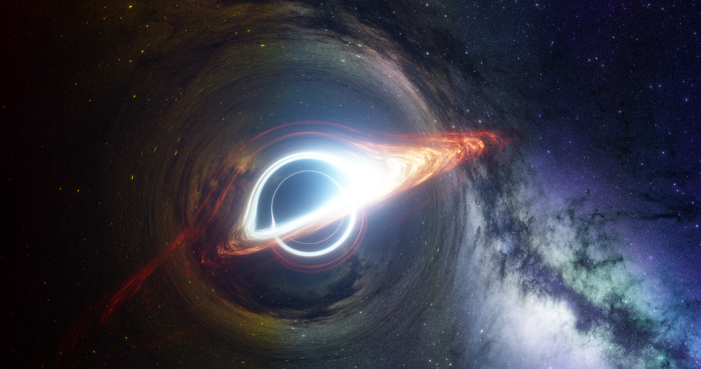
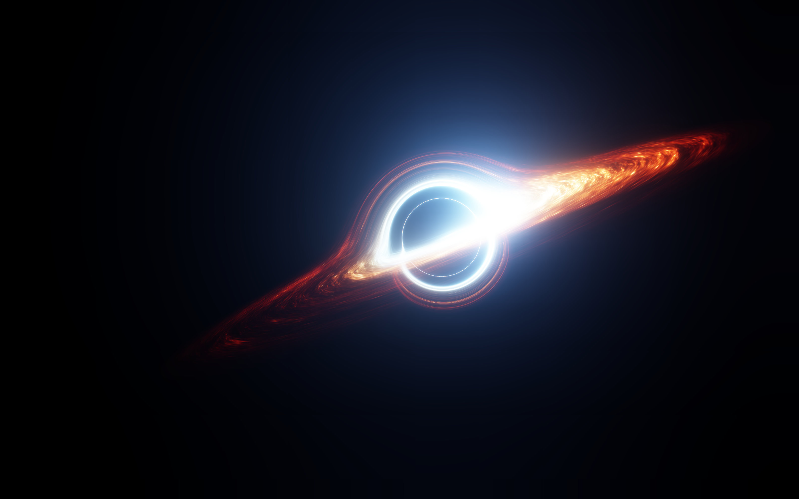
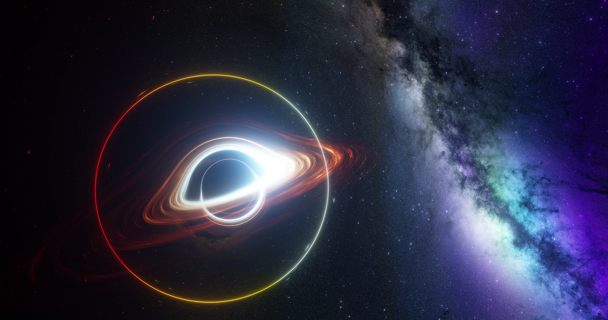

## A simple CUDA black-hole renderer

A lightweight CUDA renderer with single-GPU, hybrid GPU/CPU, and realtime
render paths. The scripts stay independent and can be read or modified directly.

## Setup

### Sky background

The default renderer uses NASA SVS's **An Elsewhere Starfield**:

- Source: https://svs.gsfc.nasa.gov/4856/
- File: `starmap_random_2020_16k.exr`

Download the 16K EXR and place it at:

```text
assets/starmap_random_2020_16k.exr
```

Please keep the NASA SVS attribution when redistributing screenshots or derived
material that uses this background.

### License

The repository's source code is licensed under the GNU General Public License,
version 3 or later (`GPL-3.0-or-later`); see [LICENSE](LICENSE). This does not
apply to the NASA SVS assets in `assets/`, which retain their original terms and
required attribution.

### Offline rendering

The normal offline path does not require a system-wide CUDA Toolkit installation.
A recent NVIDIA driver plus the CUDA-enabled CuPy wheel with CUDA Toolkit
components is enough.

```powershell
conda create -n blackhole python=3.10
conda activate blackhole
pip install "cupy-cuda12x[ctk]" numpy opencv-python OpenEXR
```

Copy `cfg/offline_example.py` to the ignored `cfg/offline.py` and edit the
values there before rendering.

### Realtime preview on Windows

CUDA/OpenGL interop also needs `cudart64_*.dll`. Installing CUDA Toolkit 12.x
provides the runtime used by the preview.

```powershell
conda activate blackhole
pip install glfw PyOpenGL
```

### CPU accelerator on Windows or Linux HPC

The hybrid renderer can assign frames to one CPU worker alongside the GPUs.
Build the native module first:

```bash
pip install pybind11
python tools/build_cpu_render.py
```

`clang++` and `lld` are required by the current build script.
The generated `cpu_render_native*.pyd` or `.so` is stored under `build/`.

The production CPU renderer requires **AVX2**. If **AVX-512F** and
**AVX-512DQ** are available, the AVX-512 backend is selected automatically.

## Hardware

- NVIDIA GPU with Compute Capability 5.0 or newer
- NVIDIA driver 545 or newer
- CPU accelerator: x86-64 CPU with AVX2
- Optional CPU fast path: AVX-512F + AVX-512DQ

## Commands

```bash
# Simple single-GPU offline renderer
python render_single.py

# Frame-parallel renderer using all GPUs
python render_hybrid.py --gpus all

# Add a CPU accelerator to the GPU workers
python render_hybrid.py --gpus all --use-cpu --cpu-cores 112

# Full-resolution CPU test using cfg/offline.py
python render_cpu.py

# Realtime CUDA/OpenGL preview
python render_realtime.py
```

Offline runs write a timestamped `run_*.json` beside their frames so camera,
sampling, input paths, devices, and timing are not lost.

`render_single.py` starts the camera at `cam_pos_init` with initial local
velocity `(vx, vy, vz)` along camera forward/right/up, in units of c.
After saving each frame, `update_after_frame(...)` advances a timelike
Schwarzschild geodesic by `d_tau` of camera proper time and packs the next
frame's position, velocity, and coordinate time. The first frame uses the
configured state exactly; zero initial velocity releases the camera from rest.
The configured viewing axes stay fixed in world coordinates. Transverse initial
velocity may produce orbital motion or escape, rather than a radial plunge.
Rendering stops before the existing `r=0.55` cutoff. A `run_*_camera.json`
beside the manifest records the state used for every rendered frame.
This camera motion applies to the single-GPU renderer; the CPU/hybrid frame
schedulers retain their existing fixed-camera behavior.

Use `python render_single.py --start 33` to save this run as
`frame_00033.png`, `frame_00034.png`, etc. The camera still starts from the
current cfg position, initial velocity, and `start_t`; `--start` changes output
numbering only, with no skipped physics steps. `total_frames` remains the number
of frames to render in this run. The output numbering also appears in the
trajectory log and manifest. Without `--start`, numbering begins at 1.

The default disk material uses native main noise, independent emission and
extinction modulation (factor 3), the outward-thickening warped Gaussian
envelope (factor 4), and factor 5's extinction/transfer changes. Main's
temperature perturbation `T = T0 * exp(0.67*n)` remains enabled. It does not
enable the separate arm/inner-cloud fields or factor 5's extra emission gain.
The background is 10 times the original offline sky exposure (`SKYBOX_SCALE=330`).

Generate its inputs before rendering:

```powershell
python tools/generate_lut_physics.py
python tools/prebake_native34.py
```

The curve is configured in **`cfg/disk_material.json`**:

| Setting | Default | Meaning |
| --- | --- | --- |
| `opacity_inner_multiplier` | 0.25 | Inner extinction multiplier |
| `opacity_outer_multiplier` | 0.20 | Outer extinction multiplier |
| `opacity_transition_start` | 8.0 | Start radius in native M units |
| `opacity_transition_end` | 30.0 | End radius in native M units |
| `emission_noise_power` | 2.4 | Emission texture contrast; 1 restores the original noise, 0 removes it |
| `extinction_noise_power` | 0.25 | Extinction texture contrast; independent of emission |

Between those radii, `m(r) = inner + (outer-inner)*t*t*(3-2*t)`, where
`t = clamp((r-start)/(end-start), 0, 1)`. Lower values increase transmission;
this multiplier changes extinction only, preserving intrinsic emission.
Run **`python tools/prebake_native34.py` again after changing the curve**,
then restart the renderer. `temperature_noise_strength` controls the temperature
perturbation; the other settings control the flared envelope.

The two noise powers independently shape `Q^emission_noise_power` and
`Q^extinction_noise_power`. Both must be finite and nonnegative. Each radial
shell is normalized to preserve its original integrated emission and extinction,
so the powers redistribute texture rather than changing the radial coefficient
totals. Apparent brightness can still change because emission and foreground
absorption overlap differently. Temperature is unaffected. Setting both powers
to 1 restores the original material at the same bake resolution; missing keys
in older settings also default to 1. Rebake after changing either value.
The tuned preset uses a `512 x 128 x 1024` bake (1 GiB of float32 coefficients).

The baker writes `cache/disk_native34_coefficients.npy` and its JSON sidecar.
Keep both together. RGBA stores `(extinction, temperature, emission, reserved)`
in float32. Enable `DISK_COEFFICIENTS=True` and point `prebaked_disk_path` to
that cache, as in `cfg/offline_example.py`. GPU and CPU use the same segment
integral for these independent coefficients, including the zero-extinction
limit. Coefficients and the envelope are baked and interpolated; the earlier
ablation evaluated the envelope analytically along each ray, so this is not
a pixel-identical representation of that experiment.

To compare a finer bake while retaining the current material settings and cache:

```powershell
python tools/prebake_native34.py --resolution 512 128 1024 --output cache/disk_native34_fine.npy
python tools/preview_disk.py --disk cache/disk_native34_coefficients.npy --width 4096 --jitter 64 --velocity 0.05 0 0 --output output_frames/disk_detail_comparison/baseline_4k
python tools/preview_disk.py --disk cache/disk_native34_fine.npy --width 4096 --jitter 64 --velocity 0.05 0 0 --output output_frames/disk_detail_comparison/fine_4k
```

Resolution order is `(r, z, phi)`. This example increases the float32 cache
from 64 MiB to 1 GiB; keep the generated JSON sidecar with it. `--width`
preserves sensor size and aspect ratio, and `--velocity` holds the observer's
velocity fixed for the single-frame comparison. Increasing bake resolution
does not filter unresolved noise octaves or change emission/extinction coupling.

The original J/A weighting (`J=1.4*D*Q`, `A=D*D*Q/0.3`) is adapted from
[baopinshui/NPGS](https://github.com/baopinshui/NPGS), GPL-3.0,
commit `91305ca1661f18b60d6d33ed4616e4cd5b977b9f`. Noise generation remains
this repository's native implementation. `tools/data/disk_core_profile.json`
is the radial mean of the earlier local cloud preset's core mask, retained
from the ablation for `kappa_original(r)=0.5*(0.6+8.4*core(r))`; it is an
artistic material profile, not a physical prediction. The configured curve
multiplies this profile: `kappa_eff(r)=kappa_original(r)*m(r)`.

Experimental multiscale baking is available separately in
`cfg/disk_material_multiscale.json`:

```powershell
python tools/prebake_native34.py --settings cfg/disk_material_multiscale.json --output output_frames/disk_multiscale_experiment/balanced/disk.npy
python tools/preview_disk.py --disk output_frames/disk_multiscale_experiment/balanced/disk.npy --jitter 32 --save-linear --output output_frames/disk_multiscale_experiment/preview
```

`noise_mode="filtered"` enables voxel-footprint octave attenuation and eight
subvoxel samples of the nonlinear emission, extinction and temperature factors.
`noise_octave_start` selects the largest structure (1 is larger than the native
2), and `noise_roughness` attenuates each following octave (experiment: 0.65).
`noise_filter_mix` blends normalized coefficients: 0 gives the legacy bake,
1 gives full filtering, and the experimental preset uses 0.35. Partial blending
retains some legacy aliasing; it is an appearance compromise. The filter is a
voxel-scale approximation, not an exact filter or a screen-space LOD system.
Per-radius means of extinction, emission and temperature are retained, while
the nonlinear rendered brightness and color can still change. Full filtering
can expose smooth orbital bands, so compare near and far views before adopting
it. `noise_mode` defaults to `legacy`; the normal material config/cache remain
independent of the experimental preset.

`tools/preview_disk.py --time 337.4885735 --exposure-scale 0.2` overrides scene
time and scales HDR before the existing bloom/tone mapping, without editing
cfg. This is useful for inspecting overexposed near-view texture; keep the same
scale across variants. `--save-linear` continues to save the unscaled HDR.
The experiment's camera snapshots, original config copies, full images, HDRs,
and comparisons are under `output_frames/disk_multiscale_experiment/`.

For the older thick clump preset, first generate the physics
LUT with `python tools/generate_lut_physics.py`, then run
`python tools/prebake_disk_noise_npgs.py`. In `cfg/offline.py`, set
`prebaked_disk_path = 'cache/prebaked_disk_clouds.npy'`, `DISK_COEFFICIENTS=False`
and `OPACITY_CHANGE=True`.
The bake script exposes inner/outer cloud heights, midplane warp, edge roughness,
outer coverage, cold-core density boost, and emission strength. Its fourth texture channel stores the
local cold-core fraction. The renderer uses that fraction to give dark cores
strong extinction and luminous regions weaker extinction, while holding the
local emission coefficient independent of the extinction multiplier. A practical
preview is 2048×1080 with 4–8 samples per pixel. When reducing the original 4096
pixel width to 2048, double `PIXEL_PITCH` to keep the same field of view.

`python tools/preview_disk.py --skybox assets/starmap_random_2020_16k.exr`
renders one 2K, 8-sample preview without editing the offline config. Use
`--step 0.005 --output output_frames/disk_step_half --save-linear` for a finer
integration comparison (the default step is 0.01). The cloud preset uses warped
3D cellular lobes and three resolved noise octaves instead of a filled Gaussian
layer. Coverage decreases toward the outer disk, creating gaps and wisps; the
azimuth resolution is 512 to resolve the cloud edges. Temperature still comes
from the original physics LUT and color uses the existing color LUT, preserving
the inner white to outer red transition. `CLOUD_EMISSION_GAIN` raises cloud
brightness without changing background exposure. This preset does not compute
illumination from the disk or the observer, scattering, or thermal equilibrium.

`CLOUD_EDGE_SOFTNESS` controls the continuous density tail around a clump;
`CLOUD_LINK_DENSITY` adds thin connected wisps between clumps. Both affect
the actual medium, rather than post-process blur. To inspect from inside the
disk, add `--camera 18 -8 1.4 --yaw 2 --pitch -0.03 --roll 0` to the preview
command. Camera overrides apply only to that preview.

CUDA sources are under `krnls/`, sky/background textures are under `assets/`,
and LUT or prebaked NumPy arrays are under `cache/`. Rendered frames, profiling
reports, `archive/`, and `failed/` remain local data ignored by Git. Paths in
`cfg/offline.py` are relative to the repository root.

## Experimental paths

The repository also contains experimental cloud-volume rendering code and
prebaking tools. These are kept for development and reference, but are **not a
supported entry point** and are not expected to work from a fresh clone without
additional local assets or setup.

## Troubleshooting

If OpenCV reports that the OpenEXR codec is disabled, enable it before launching
the renderer.

PowerShell:

```powershell
$env:OPENCV_IO_ENABLE_OPENEXR="1"
python render_single.py
```

Linux/macOS shell:

```bash
OPENCV_IO_ENABLE_OPENEXR=1 python render_single.py
```

## 中文快速开始

默认背景使用 NASA SVS 的 **An Elsewhere Starfield**。下载
`starmap_random_2020_16k.exr` 后放到：

```text
assets/starmap_random_2020_16k.exr
```

来源页面：

https://svs.gsfc.nasa.gov/4856/

离线渲染只需要兼容的 NVIDIA 驱动和带 CUDA Toolkit 组件的 CuPy wheel，
通常不需要在系统中单独安装完整 CUDA Toolkit：

```powershell
conda create -n blackhole python=3.10
conda activate blackhole
pip install "cupy-cuda12x[ctk]" numpy opencv-python OpenEXR
```

随后将 `cfg/offline_example.py` 复制为 `cfg/offline.py` 并修改参数：

```powershell
python render_single.py
python render_hybrid.py --gpus all
python render_hybrid.py --gpus all --use-cpu --cpu-cores 112
python render_cpu.py
python render_realtime.py
```

CPU 原生后端最低要求 AVX2；若处理器支持 AVX-512F 与 AVX-512DQ，会自动
选择 AVX-512 路径。实时预览额外需要 CUDA/OpenGL interop、`glfw` 和
`PyOpenGL`。

仓库中的 cloud-volume 路径属于实验代码，不作为支持的 fresh-clone 入口。
