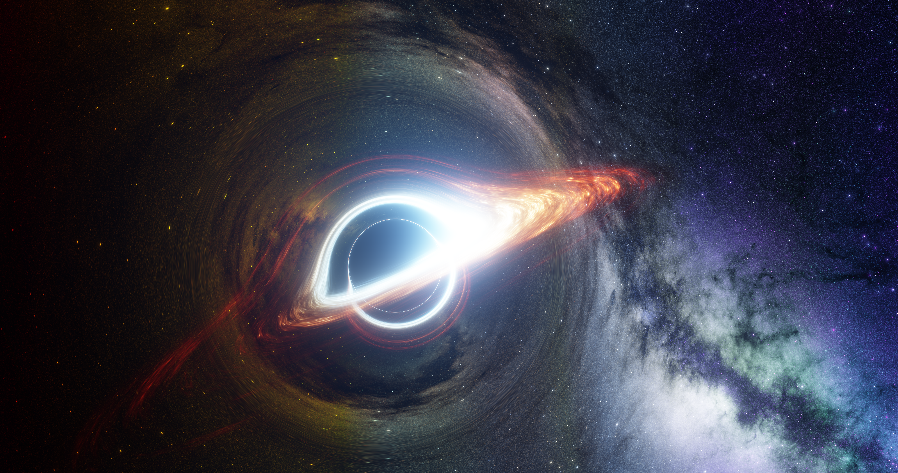
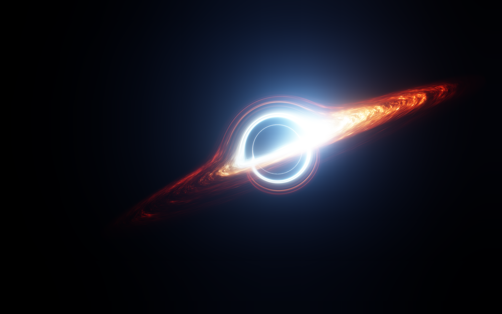
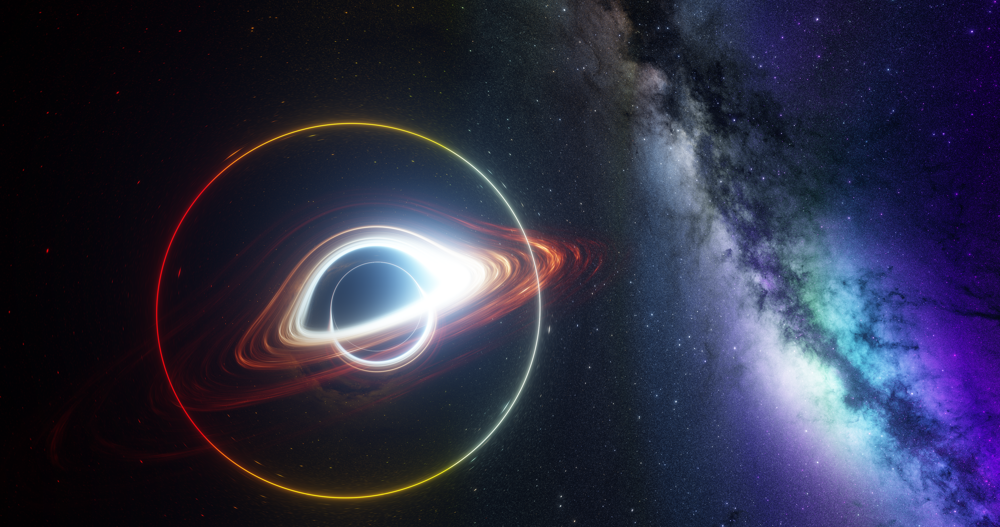

## A simple CUDA black-hole renderer

A lightweight CUDA renderer with single-GPU, hybrid GPU/CPU, and realtime
render paths. The scripts stay independent and can be read or modified directly.

## Minimal 1080p reproduction

Use a fresh checkout and the [offline Python environment](#offline-rendering).
One NVIDIA GPU runs the bake, the still render, and the A/B closure check.
The example uses the tracked physics and color LUTs. It bakes each disk at
256 radial × 64 vertical × 512 azimuthal samples (32 MiB per RGBA float32
texture) and renders at 1920×1080 with 4 samples per pixel.

From the repository root in PowerShell, download the 4096×2048 OpenEXR
starfield (34 MiB) and render one still. The background is credited to
NASA's Scientific Visualization Studio. [An Elsewhere Starfield](https://svs.gsfc.nasa.gov/4856/)

```powershell
New-Item -ItemType Directory -Force assets | Out-Null
curl.exe --fail --location --retry 3 --continue-at - --output assets/starmap_random_2020_4k.exr https://svs.gsfc.nasa.gov/vis/a000000/a004800/a004856/starmap_random_2020_4k.exr
Copy-Item cfg/repro_1080p.py cfg/offline.py
python tools/prebake_native34.py --resolution 256 64 512 --seed 1919810 --output output_frames/repro_1080p/cache/disk_a.npy
python render_single.py
```

The still is saved to `output_frames/repro_1080p/still/frame_00001.png`.
[Reference PNG from this example](docs/images/repro_1080p.png)

For the A/B check, set `DISK_LOOP_PERIOD = 40.0` in `cfg/offline.py`. The
example holds the camera fixed and renders coordinate times 7, 27, and 47.
Bake the independent B texture with the same resolution and a different seed.

```powershell
python tools/prebake_native34.py --resolution 256 64 512 --seed 2718281 --output output_frames/repro_1080p/cache/disk_b.npy
python render_single.py
python examples/check_loop_1080p.py
```

The three PNGs are saved under `output_frames/repro_1080p/loop/`. The checker
verifies the sample times, checks that the midpoint changes, and compares the
first and last images. On the tested RTX 5070 Laptop GPU, the endpoint PNGs
were byte-identical and the midpoint's mean absolute difference from the
first frame was 3.52 on the 8-bit RGB scale.

## 课程大作业说明

本项目现在作为pku 2026 计算概论B yhf班大作业。

### 项目目标与开发范围

本项目面向希望观察黑洞引力透镜现象、制作黑洞静帧或循环画面的人。给定相机、星图和吸积盘材质，程序在本地从相机反向追踪光线，生成能保存、对比和复查的画面。单卡离线渲染提供可复现的主流程，实时取景器可用来调整机位，多设备入口可分配不同的帧。固定机位的 A/B 模式用于制作能首尾衔接的吸积盘动画。课程演示包含一张 1080p 静帧，以及一次在周期起点、中点和终点取样的闭合检查。 [最小复现步骤](#minimal-1080p-reproduction) · [循环设计](docs/disk_loop.md)

**项目最初版主体于 2026 年 4 月至 5 月开发。** 仓库首个提交日期为 2026 年 5 月 31 日。后续迭代增加了 CPU 向量化、材质扩展和吸积盘 A/B 循环，提交记录可以用来区分这些阶段。 [初始提交](https://github.com/Qianyv-Li8262/Black-Hole-Render/commit/e1e6b41) · [吸积盘循环提交](https://github.com/Qianyv-Li8262/Black-Hole-Render/commit/034f5bb)

### 三维纹理查表与光线积分

- **三维数组与查表。** 烘焙器将吸积盘按半径、高度和方位角离散成规则网格。当前系数材质的每个体素存放消光系数、温度、发光强度和一个保留通道。渲染时按采样位置访问三维纹理，由硬件线性插值，以常数次查表取代每个采样点重复计算噪声和盘体包络。设三轴采样数为 `Nr`、`Nz`、`Nφ`，单份 float32 纹理占 `16 × Nr × Nz × Nφ` 字节。示例的 `256×64×512` 每份占 32 MiB，默认的 `512×128×1024` 每份占 1 GiB。A/B 多存一份独立纹理，并在盘内取样时读取两份。降低网格分辨率会减少烘焙和显存开销，同时损失细小纹理。 [烘焙器](tools/prebake_native34.py) · [CUDA 纹理采样](krnls/disk.cu)
- **数值积分与采样。** 每个像素从相机反向追踪光线。积分器保留当前位置、动量、传播时间和累计的光学量，每条光线的状态占常数空间。默认用二阶 Runge–Kutta（RK2），另有 RK4 实现。步长随位置调整，在盘内缩小步长以减少跳过细节的情况。RK4 单步求导次数更多，代码中的 RK4 选项也放宽了步长，因此速度与盘面采样效果需要一起检查。对宽 `W`、高 `H`、每像素 `S` 个样本、每条光线最多 `K` 步的图像，单帧光线推进工作的上界是 `O(W × H × S × K)`。提高采样数有助于降低像素噪声，缩小步长有助于解析沿光线的变化，两者都会增加工作量。 [光线积分核](krnls/disk.cu) · [分段辐射传输](krnls/radiative_transfer.h)

A/B 模式用光线传播时间推算吸积盘的发光时刻，在每个盘内采样点混合两套独立纹理的消光和发光，再沿光线累计。这样循环发生在渲染过程中的材质上，首尾闭合也可以直接用实际输出帧检验。 [延迟时间与周期闭合](docs/disk_loop.md#radiative-transfer-and-closure)

### 测试与结果

在 Windows、Python 3.10.20、RTX 5070 Laptop GPU 和支持 AVX2 的 CPU 环境下，`python -m unittest discover -s tests -v` 共 **49 项通过**。运行整套测试前，按下文准备 [离线环境](#offline-rendering) 和 [CPU 扩展](#cpu-accelerator-on-windows-or-linux-hpc)。

| 检查 | 代表性结果 |
| :--- | :--- |
| 解析解对照 | 均匀介质的辐射传输与解析解一致，径向光线的传播延迟也通过了独立解析对照。 [传输测试](tests/test_radiative_transfer.py) · [循环测试](tests/test_disk_loop.py) |
| 后端一致性 | 标量与 AVX2 在包含边缘分块和 RK4 的用例中通过比较，CPU 与 CUDA 在有消光和零消光的系数材质用例中通过容差检查。 [AVX2 测试](tests/test_cpu_avx2.py) · [CPU/CUDA 对照](tests/test_radiative_transfer.py) |
| 1080p 实际输出 | 用 NASA 4K EXR 在干净目录生成静帧和 A/B 三帧。`t=7` 与 `t=47` 的 PNG 字节相同，`t=27` 相对首帧的 RGB 平均绝对差为 **3.52**（8 位色阶）。把中间帧替换为首帧后，校验脚本判定失败。 [示例输出](docs/images/repro_1080p.png) · [闭合校验脚本](examples/check_loop_1080p.py) |
| 边界与异常 | PNG 天空盒、A/B 重复 seed、烘焙参数不匹配和实际数组尺寸与元数据不符的用例均按预期被拒绝。 [入口测试](tests/test_hybrid_loop.py) · [缓存校验测试](tests/test_native34_material.py) |

### 局限与改进

- 黑洞采用非旋转的 Schwarzschild 模型。吸积盘使用预烘焙的程序化发光和消光材质，可选固定时刻的 HG 散射表。A/B 循环驱动材质动画，流体演化仍未模拟。
- 烘焙和 A/B 渲染需要 CUDA。闭合示例使用静止相机，CPU 路径支持单纹理渲染。本机编译通过了 AVX-512 路径，实际运行验证覆盖 AVX2 和 CUDA。
- 进一步评估可用固定机位分别改变积分步长、每像素采样数和纹理分辨率，记录耗时与输出差异。AVX-512 的运行验证需要支持该指令集的机器。

### AI 使用声明与本人贡献

- **工具与参与环节。** 开发项目主体期间主要混合使用 Claude Opus 4.6 和 Gemini 3.1 Pro Preview。后续使用 Codex 协助检查历史代码、定位和修复 CPU 数值差异、验证异常处理、跑通 1080p 最小示例并整理文档。**
- **本人完成的工作。** 我手推了项目主体使用的物理公式，CUDA kernel 主体约一半由我手写。后续我明确要求相机速度越界时保持窗口响应并显示黑屏，也决定让 A/B 周期继续由 Python 配置显式给出。
- **验证依据。** 在 CPU 一致性修复中，先复现了三项原有的测试失败，定位到 SIMD 路径与标量路径使用的消光公式有差异，再重编 CPU 扩展并重跑测试。A/B 示例用真实 CUDA 出帧，对比首尾 PNG，并用复制中间帧的反例检查验证脚本能否识别无变化的画面。 [CPU 修复提交](https://github.com/Qianyv-Li8262/Black-Hole-Render/commit/efe1936) · [验证结果](#测试与结果)
- **外部资源。** NASA SVS 的星图用作背景输入，NPGS 的 J/A 权重用作早期材质方案的参考。CuPy 用于编译和调用 CUDA kernel，OpenEXR 读取星图，OpenCV 保存或比较图像，pybind11 连接 Python 与 C++ 后端。 [NASA 星图](https://svs.gsfc.nasa.gov/4856/) · [NPGS 源码](https://github.com/baopinshui/NPGS) · [许可证](LICENSE)

## Setup

### Sky background

The disk renderers require an RGB OpenEXR (`.exr`) skybox.
The default renderer uses NASA SVS's **An Elsewhere Starfield**:

- Source: https://svs.gsfc.nasa.gov/4856/
- File: `starmap_random_2020_16k.exr`

Download the 16K EXR and place it at:

```text
assets/starmap_random_2020_16k.exr
```

Please keep the NASA SVS attribution when redistributing screenshots or derived
material that uses this background.

### License

The repository's source code is licensed under the GNU General Public License,
version 3 or later (`GPL-3.0-or-later`); see [LICENSE](LICENSE). This does not
apply to the NASA SVS assets in `assets/`, which retain their original terms and
required attribution.

### Offline rendering

The normal offline path does not require a system-wide CUDA Toolkit installation.
A recent NVIDIA driver plus the CUDA-enabled CuPy wheel with CUDA Toolkit
components is enough.

```powershell
conda create -n blackhole python=3.10
conda activate blackhole
pip install "cupy-cuda12x[ctk]" numpy opencv-python OpenEXR
```

Copy `cfg/offline_example.py` to the ignored `cfg/offline.py` and edit the
values there before rendering.

### Realtime preview on Windows

CUDA/OpenGL interop also needs `cudart64_*.dll`. Installing CUDA Toolkit 12.x
provides the runtime used by the preview.

```powershell
conda activate blackhole
pip install glfw PyOpenGL
```

`python render_realtime.py` starts with scattering disabled, even if the offline
config enables it. Use `python render_realtime.py --scatter` to load the
configured table independently of the offline switch.

### CPU accelerator on Windows or Linux HPC

The hybrid renderer can assign frames to one CPU worker alongside the GPUs.
Build the native module first:

```bash
pip install pybind11
python tools/build_cpu_render.py
```

`clang++` is required by the current build script. `lld` is required on
Windows; on Linux it is used when installed, otherwise the system linker is used.
The generated `cpu_render_native*.pyd` or `.so` is stored under `build/`.

The production CPU renderer requires **AVX2**. If **AVX-512F** and
**AVX-512DQ** are available, the AVX-512 backend is selected automatically.

## Hardware

- NVIDIA GPU with Compute Capability 5.0 or newer
- NVIDIA driver 545 or newer
- CPU accelerator: x86-64 CPU with AVX2
- Optional CPU fast path: AVX-512F + AVX-512DQ

## Commands

```bash
# Simple single-GPU offline renderer
python render_single.py

# Frame-parallel renderer using all GPUs
python render_hybrid.py --gpus all

# A/B loop on all GPUs: enable DISK_LOOP_PERIOD in cfg/offline.py
python render_hybrid.py --gpus all --time-step 0.5

# Add a CPU accelerator to the GPU workers
python render_hybrid.py --gpus all --use-cpu --cpu-cores 112

# Full-resolution CPU test using cfg/offline.py
python render_cpu.py

# Realtime CUDA/OpenGL preview
python render_realtime.py
```

Offline runs write a timestamped `run_*.json` beside their frames so camera,
sampling, input paths, devices, and timing are not lost.
Set `BLOOM_THRESHOLD` in `cfg/offline.py` to share a threshold across disk
renderers. The default is `7.0`.

`render_single.py` starts the camera at `cam_pos_init` with initial local
velocity `(vx, vy, vz)` along camera forward/right/up, in units of c.
After saving each frame, `update_after_frame(...)` advances a timelike
Schwarzschild geodesic by `d_tau` of camera proper time and packs the next
frame's position, velocity, and coordinate time. The first frame uses the
configured state exactly; zero initial velocity releases the camera from rest.
The configured viewing axes stay fixed in world coordinates. Transverse initial
velocity may produce orbital motion or escape, rather than a radial plunge.
Rendering stops before the existing `r=0.55` cutoff. A `run_*_camera.json`
beside the manifest records the state used for every rendered frame.
This camera motion applies to the single-GPU renderer; the CPU/hybrid frame
schedulers retain their existing fixed-camera behavior.

Use `python render_single.py --start 33` to save this run as
`frame_00033.png`, `frame_00034.png`, etc. The camera still starts from the
current cfg position, initial velocity, and `start_t`; `--start` changes output
numbering only, with no skipped physics steps. `total_frames` remains the number
of frames to render in this run. The output numbering also appears in the
trajectory log and manifest. Without `--start`, numbering begins at 1.

The default disk material uses native main noise, independent emission and
extinction modulation (factor 3), the outward-thickening warped Gaussian
envelope (factor 4), and factor 5's extinction/transfer changes. Main's
temperature perturbation `T = T0 * exp(0.67*n)` remains enabled. It does not
enable the separate arm/inner-cloud fields or factor 5's extra emission gain.
The background is 10 times the original offline sky exposure (`SKYBOX_SCALE=330`).

Generate its inputs before rendering:

```powershell
python tools/generate_lut_physics.py
python tools/prebake_native34.py
```

The curve is configured in **`cfg/disk_material.json`**:

| Setting | Default | Meaning |
| --- | --- | --- |
| `opacity_inner_multiplier` | 0.25 | Inner extinction multiplier |
| `opacity_outer_multiplier` | 0.20 | Outer extinction multiplier |
| `opacity_transition_start` | 8.0 | Start radius in native M units |
| `opacity_transition_end` | 30.0 | End radius in native M units |
| `emission_noise_power` | 2.4 | Emission texture contrast; 1 restores the original noise, 0 removes it |
| `extinction_noise_power` | 0.25 | Extinction texture contrast; independent of emission |

Between those radii, `m(r) = inner + (outer-inner)*t*t*(3-2*t)`, where
`t = clamp((r-start)/(end-start), 0, 1)`. Lower values increase transmission;
this multiplier changes extinction only, preserving intrinsic emission.
Run **`python tools/prebake_native34.py` again after changing the curve**,
then restart the renderer. `temperature_noise_strength` controls the temperature
perturbation; the other settings control the flared envelope.

The default `envelope_mode="legacy_outer_flare"` retains the original Gaussian
inner envelope, including `height_inner=0.22`, `height_outer=1.05`, height
variation 0.55 and midplane warp 0.35. Only the outer envelope is stretched
vertically. The stretch is 1 inside the hot region and grows smoothly to
`outer_height_multiplier=1.6` using the base temperature LUT's outer cooling
branch: 4500K at r=8.2307M through 1800K at r=13.1373M. Explicit
`height_transition_start/end` radii are supported when temperature keys are absent.
With `t=clamp((r-start)/(end-start),0,1)`, the stretch is
`S=1+(outer_height_multiplier-1)*(t*t*(3-2*t))^height_power` (power 1.5).
The original envelope is evaluated at `z/S`, including its original +-2.5M
cutoff. Thus inner geometry is restored while outer vertical support reaches
8M total, exceeding the Schwarzschild shadow impact radius `sqrt(27)M`.
This is envelope support; visible thickness depends on opacity and lensing.
The vertical texture domain is now +-4M and is stored in the JSON sidecar;
GPU and CPU renderers read it automatically. Older caches default to +-2.5M.
`envelope_mode="legacy"` selects the original Gaussian without outer stretching;
`bounded_flare` retains the alternative compact thin-inner profile.
Rebake **both A and B** when changing the envelope in a looping scene:

```powershell
python tools/prebake_native34.py
python tools/prebake_native34.py --seed 2718281 --output cache/disk_native34_b.npy
```

The two noise powers independently shape `Q^emission_noise_power` and
`Q^extinction_noise_power`. Both must be finite and nonnegative. Each radial
shell is normalized to preserve its original integrated emission and extinction,
so the powers redistribute texture rather than changing the radial coefficient
totals. Apparent brightness can still change because emission and foreground
absorption overlap differently. Temperature is unaffected. Setting both powers
to 1 restores the original material at the same bake resolution; missing keys
in older settings also default to 1. Rebake after changing either value.
The tuned preset uses a `512 x 128 x 1024` bake (1 GiB of float32 coefficients).

The baker writes `cache/disk_native34_coefficients.npy` and its JSON sidecar.
Keep both together. RGBA stores `(extinction, temperature, emission, reserved)`
in float32. Enable `DISK_COEFFICIENTS=True` and point `prebaked_disk_path` to
that cache, as in `cfg/offline_example.py`. GPU and CPU use the same segment
integral for these independent coefficients, including the zero-extinction
limit. Coefficients and the envelope are baked and interpolated; the earlier
ablation evaluated the envelope analytically along each ray, so this is not
a pixel-identical representation of that experiment.

To compare a finer bake while retaining the current material settings and cache:

```powershell
python tools/prebake_native34.py --resolution 512 128 1024 --output cache/disk_native34_fine.npy
python tools/preview_disk.py --disk cache/disk_native34_coefficients.npy --width 4096 --jitter 64 --velocity 0.05 0 0 --output output_frames/disk_detail_comparison/baseline_4k
python tools/preview_disk.py --disk cache/disk_native34_fine.npy --width 4096 --jitter 64 --velocity 0.05 0 0 --output output_frames/disk_detail_comparison/fine_4k
```

Resolution order is `(r, z, phi)`. This example increases the float32 cache
from 64 MiB to 1 GiB; keep the generated JSON sidecar with it. `--width`
preserves sensor size and aspect ratio, and `--velocity` holds the observer's
velocity fixed for the single-frame comparison. Increasing bake resolution
does not filter unresolved noise octaves or change emission/extinction coupling.

The original J/A weighting (`J=1.4*D*Q`, `A=D*D*Q/0.3`) is adapted from
[baopinshui/NPGS](https://github.com/baopinshui/NPGS), GPL-3.0,
commit `91305ca1661f18b60d6d33ed4616e4cd5b977b9f`. Noise generation remains
this repository's native implementation. `tools/data/disk_core_profile.json`
is the radial mean of the earlier local cloud preset's core mask, retained
from the ablation for `kappa_original(r)=0.5*(0.6+8.4*core(r))`; it is an
artistic material profile, not a physical prediction. The configured curve
multiplies this profile: `kappa_eff(r)=kappa_original(r)*m(r)`.

Experimental multiscale baking is available separately in
`cfg/disk_material_multiscale.json`:

```powershell
python tools/prebake_native34.py --settings cfg/disk_material_multiscale.json --output output_frames/disk_multiscale_experiment/balanced/disk.npy
python tools/preview_disk.py --disk output_frames/disk_multiscale_experiment/balanced/disk.npy --jitter 32 --save-linear --output output_frames/disk_multiscale_experiment/preview
```

`noise_mode="filtered"` enables voxel-footprint octave attenuation and eight
subvoxel samples of the nonlinear emission, extinction and temperature factors.
`noise_octave_start` selects the largest structure (1 is larger than the native
2), and `noise_roughness` attenuates each following octave (experiment: 0.65).
`noise_filter_mix` blends normalized coefficients: 0 gives the legacy bake,
1 gives full filtering, and the experimental preset uses 0.35. Partial blending
retains some legacy aliasing; it is an appearance compromise. The filter is a
voxel-scale approximation, not an exact filter or a screen-space LOD system.
Per-radius means of extinction, emission and temperature are retained, while
the nonlinear rendered brightness and color can still change. Full filtering
can expose smooth orbital bands, so compare near and far views before adopting
it. `noise_mode` defaults to `legacy`; the normal material config/cache remain
independent of the experimental preset.

`tools/preview_disk.py --time 337.4885735 --exposure-scale 0.2` overrides scene
time and scales HDR before the existing bloom/tone mapping, without editing
cfg. This is useful for inspecting overexposed near-view texture; keep the same
scale across variants. `--save-linear` continues to save the unscaled HDR.
The experiment's camera snapshots, original config copies, full images, HDRs,
and comparisons are under `output_frames/disk_multiscale_experiment/`.

An opt-in two-texture wallpaper loop retains retarded-time sampling and bounded
differential shear. See [disk loop physics and commands](docs/disk_loop.md).
Bake an independent B with `tools/prebake_native34.py --seed 2718281 --output cache/disk_native34_b.npy`,
then set `DISK_LOOP_PERIOD = 40.0` and `DISK_LOOP_TEXTURE_B` in `cfg/offline.py`
and run `python tools/preview_disk.py --loop-frames 120 --velocity 0 0 0`.
The realtime and offline disk renderers read the period from `cfg/offline.py`.
Set `DISK_LOOP_PERIOD = 0.0` explicitly for single-texture rendering.

For the older thick clump preset, first generate the physics
LUT with `python tools/generate_lut_physics.py`, then run
`python tools/prebake_disk_noise_npgs.py`. In `cfg/offline.py`, set
`prebaked_disk_path = 'cache/prebaked_disk_clouds.npy'`, `DISK_COEFFICIENTS=False`
and `OPACITY_CHANGE=True`.
The bake script exposes inner/outer cloud heights, midplane warp, edge roughness,
outer coverage, cold-core density boost, and emission strength. Its fourth texture channel stores the
local cold-core fraction. The renderer uses that fraction to give dark cores
strong extinction and luminous regions weaker extinction, while holding the
local emission coefficient independent of the extinction multiplier. A practical
preview is 2048×1080 with 4–8 samples per pixel. When reducing the original 4096
pixel width to 2048, double `PIXEL_PITCH` to keep the same field of view.

`python tools/preview_disk.py --skybox assets/starmap_random_2020_16k.exr`
renders one 2K, 8-sample preview without editing the offline config. Use
`--step 0.005 --output output_frames/disk_step_half --save-linear` for a finer
integration comparison (the default step is 0.01). The cloud preset uses warped
3D cellular lobes and three resolved noise octaves instead of a filled Gaussian
layer. Coverage decreases toward the outer disk, creating gaps and wisps; the
azimuth resolution is 512 to resolve the cloud edges. Temperature still comes
from the original physics LUT and color uses the existing color LUT, preserving
the inner white to outer red transition. `CLOUD_EMISSION_GAIN` raises cloud
brightness without changing background exposure. This preset does not compute
illumination from the disk or the observer, scattering, or thermal equilibrium.

`CLOUD_EDGE_SOFTNESS` controls the continuous density tail around a clump;
`CLOUD_LINK_DENSITY` adds thin connected wisps between clumps. Both affect
the actual medium, rather than post-process blur. To inspect from inside the
disk, add `--camera 18 -8 1.4 --yaw 2 --pitch -0.03 --roll 0` to the preview
command. Camera overrides apply only to that preview.

CUDA sources are under `krnls/`, sky/background textures are under `assets/`,
and LUT or prebaked NumPy arrays are under `cache/`. Rendered frames, profiling
reports, `archive/`, and `failed/` remain local data ignored by Git. Paths in
`cfg/offline.py` are relative to the repository root.

## Offline cloud scattering

Set up the coefficient material and `cfg/offline.py` as above. The bake needs
the disk `.npy` file(s), their `.json` sidecars, the color LUT, and a working
CuPy/CUDA environment. The skybox and the CPU extension are only needed by
rendering paths that use them.

```bash
python bake_scatter.py --grid 32 8 64 --epochs 2 --maxstep 8000 --output output_frames/scatter_smoke --resume-latest
python bake_scatter.py --epochs 4 --maxstep 8000 --g 0.8 --albedo 0.8 --output output_frames/scatter --resume-latest
```

Repeat the full-size command after an interruption. `--resume-latest` checks
the last published epoch in the output directory. Keep the inputs and solver
options fixed and increase `--epochs` to extend the same bake. To continue
from a specific checkpoint or a checkpoint in another directory, pass
`--resume PATH/epoch.json` instead.

The default grid is 512 radial × 32 vertical × 512 azimuthal cells, maximum SH
degree 5 and 256 directions per cell.
Each GPU thread traces all directions for one cell. Adjacent threads follow the
same local direction from neighboring azimuths. At 256 directions the default
launch covers 16,384 cells. Use `--chunk` to adjust the number of cells per launch.
The solver reads one previous-epoch table and builds the next table. It stages
the next `epoch.json` and `table.npy` on the output filesystem, publishes them
as a directory, then removes older rolling checkpoints. At the default size
the latest table uses 1.6875 GiB and writing its successor needs about 3.375 GiB
for the pair. On Linux the solver reserves disk blocks up front when the
filesystem supports it. Use `--keep-epochs` to archive every completed epoch for
comparison. Existing archives and input checkpoints under other output paths
are kept.
An interrupted process may leave a hidden `.scatter-*` staging directory.
The resume command uses published epoch directories only. Once no bake is
running, abandoned staging directories can be removed to recover disk space.
Copy the selected directory to the rendering machine and set in `cfg/offline.py`:

```python
OPEN_SCATTER = True
SCATTER_TABLE = 'output_frames/scatter/epoch_0004/epoch.json'
```

Single-GPU and hybrid GPU workers use `OPEN_SCATTER`. Set it to `False` to
disable scattering while keeping the path. Realtime uses `--scatter`. The GPU
keeps one table at render time. Use matching disk texture(s), color LUT and
loop settings. The table describes a frozen world-space snapshot at `--time`
(default `start_t`), including the A/B material mixture at that instant when
enabled. Direct disk animation still uses the renderer's retarded times.
A moving camera samples the frozen lighting from its new direction. Scattering
transports linear RGB with grey bolometric frequency gain; scattered light uses
the emitting fluid frame and keeps its RGB chromaticity between events.

Each probe traces disk emission plus the previous complete epoch using midpoint
volume samples and the configured RK method. The incident directions are future
photon directions in the comoving radial/azimuthal/vertical basis. Each
normalized Henyey–Greenstein convolution multiplies SH band `l` by `g**l`
(positive `g` is forward scattering). Set `SCATTER_G` to preview another phase
on epoch 1. Subsequent epochs depend on the earlier phase and albedo; resume from
epoch 1 with the new parameters and a separate output directory to recompute them.
Scattering reuses a fraction of the existing extinction and the full-resolution
disk density. Truncated SH reconstruction clamps negative scattered radiance
to zero. The sky contributes direct background light only.

The JSON records the input hashes, scene time, grid, solver options, phase,
epoch, elapsed time, ray count, and rays that reached `maxstep`. Increase the
step budget if many rays truncate. `relative_scatter_rms` compares the current
and preceding quantized, phase-weighted SH coefficients with volume and squared
scattering-coefficient weights, before the per-direction clamp. Increase angular
resolution independently to check quadrature error.

## Experimental paths

The repository also contains experimental cloud-volume rendering code and
prebaking tools. These are kept for development and reference, but are **not a
supported entry point** and are not expected to work from a fresh clone without
additional local assets or setup.

## 中文快速开始

默认背景使用 NASA SVS 的 **An Elsewhere Starfield**。下载
`starmap_random_2020_16k.exr` 后放到：

```text
assets/starmap_random_2020_16k.exr
```

来源页面：

https://svs.gsfc.nasa.gov/4856/

离线渲染只需要兼容的 NVIDIA 驱动和带 CUDA Toolkit 组件的 CuPy wheel，
通常不需要在系统中单独安装完整 CUDA Toolkit：

```powershell
conda create -n blackhole python=3.10
conda activate blackhole
pip install "cupy-cuda12x[ctk]" numpy opencv-python OpenEXR
```

随后将 `cfg/offline_example.py` 复制为 `cfg/offline.py` 并修改参数：

```powershell
python render_single.py
python render_hybrid.py --gpus all
python render_hybrid.py --gpus all --use-cpu --cpu-cores 112
python render_cpu.py
python render_realtime.py
```

CPU 原生后端最低要求 AVX2；若处理器支持 AVX-512F 与 AVX-512DQ，会自动
选择 AVX-512 路径。实时预览额外需要 CUDA/OpenGL interop、`glfw` 和
`PyOpenGL`。

仓库中的 cloud-volume 路径属于实验代码，不作为支持的 fresh-clone 入口。
